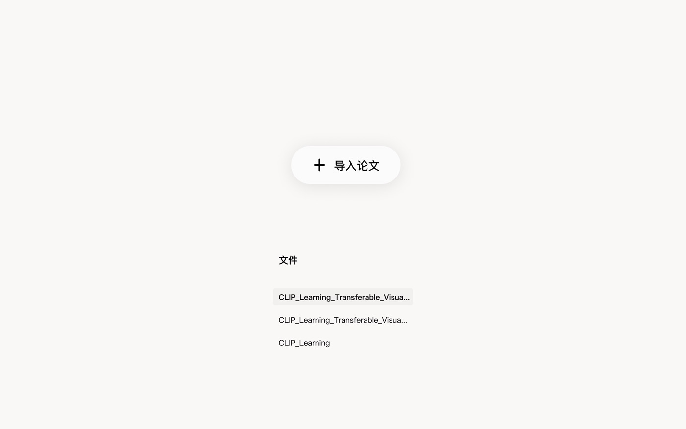
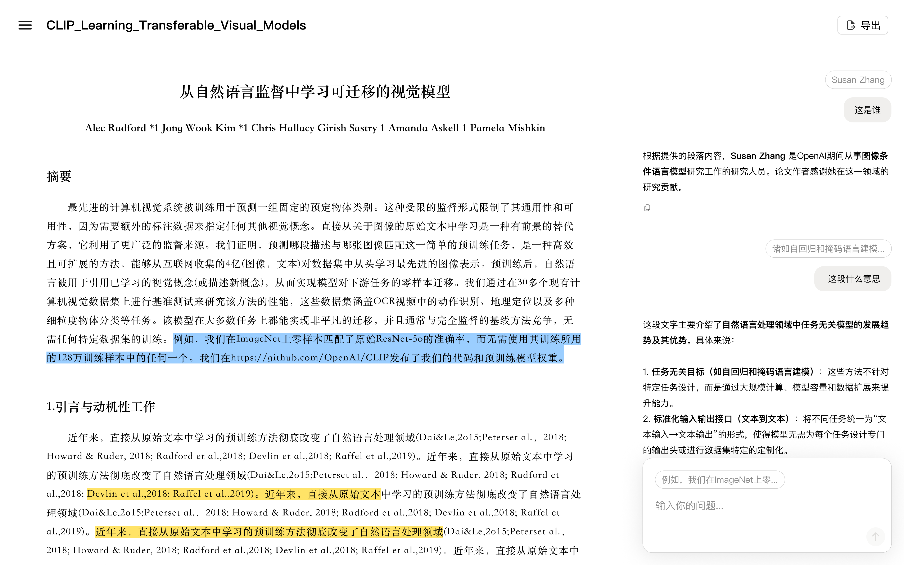
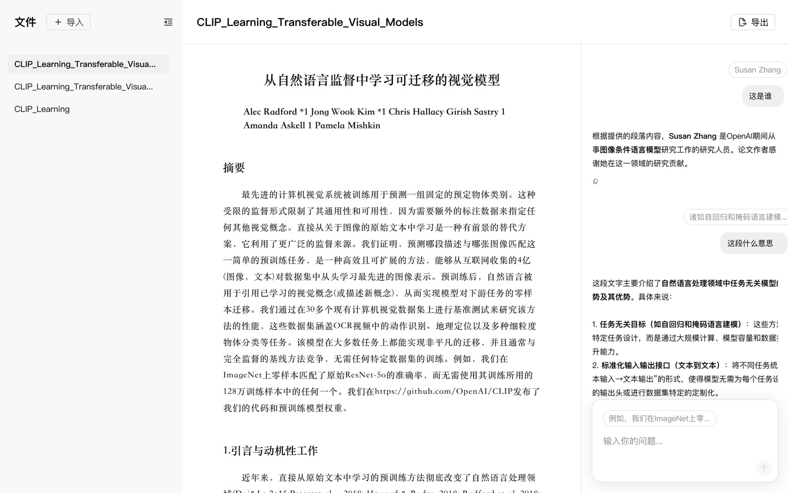

# 论文精读工作台

<p align="center">
  
  
  
  
  
</p>

> 一个面向英文论文的轻量精读工作台。导入 PDF → 自动翻译为中文 → 像读文章一样高亮加粗 → 选中段落直接追问 AI。全部在本地完成。

## 产品截图

### 启动页



### 阅读页：对话管理



### 阅读页：侧边栏展开态



---

## 为什么做

现有工具在精读论文时总差一步：

| 工具 | 能翻译 | 能问 AI | 能在译文上标注 |
|------|:---:|:---:|:---:|
| **IMA** | ✅ | ✅ | ❌ 译文只是渲染层，不能高亮加粗 |
| **Notion + PDF** | ❌ | ✅ | ❌ PDF 导入易乱，译文不是可操作文本 |
| **ChatGPT / DeepSeek** | ❌ | ✅ | ❌ 问完还得回 PDF 阅读器做标注 |
| **这个工具** | ✅ | ✅ | ✅ 翻译 → 阅读 → 标注 → 提问，一站完成 |

核心判断：**用户真正需要操作的是译文阅读层，不是翻译后的 PDF 页面。**

---

## 核心体验

### 1. 译文是主内容

打开论文后默认看到排版清晰的中文。英文原文作为隐藏上下文，AI 对话时自动携带——你不需要它占阅读空间，但 AI 需要它来保证回答质量。

### 2. 标注发生在译文上

选中文本即可**高亮**（标记"值得回看"）或**加粗**（标记"概念/方法重点"）。标注绑定到结构化文本块，不依赖 PDF 坐标，译文重排也不会漂移。

### 3. 选区就是上下文

选中任意段落，右侧 AI Chat 自动知道：
- 你选中的中文译文
- 对应英文原文
- 所在章节标题
- 论文标题

**不用复制粘贴，不用解释背景。** 选中一段 CLIP 论文的方法描述，直接问"这段的贡献是什么"，AI 的回答会基于完整上下文。

---

## 快速开始

### 前置要求

- macOS（Apple Silicon / Intel）
- Node.js 18+
- [DeepSeek API Key](https://platform.deepseek.com/)

### 安装运行

```bash
git clone https://github.com/zhangzitaooo/paper-reading-workbench.git
cd paper-reading-workbench
npm install
echo "DEEPSEEK_API_KEY=你的API-Key" > .env.local
npm run dev
```

### 使用流程

1. 打开应用 → 导入英文 PDF 论文
2. 系统自动解析结构并逐段翻译为中文（进度实时可见）
3. 在阅读区读译文，选中关键段落做高亮/加粗标注
4. 选中不懂的段落 → 在右侧 Chat 直接提问
5. 所有数据（标注、对话记录）自动保存在本地

---

## 技术栈

| 层 | 技术 |
|----|------|
| 桌面壳 | Electron |
| 前端 | React 18 + TypeScript + Vite |
| PDF 解析 | pdfjs-dist |
| AI 服务 | DeepSeek API（deepseek-v4-pro） |
| LLM 编排 | 三层策略引擎（LlmHarness → DialogueManager → ToolCallingHarness） |
| 存储 | 本地 JSON 文件（`~/Documents/PaperReadingWorkbench/`） |

---

## 项目结构

```
src/          # React 前端（阅读区、Chat、标注工具栏）
electron/     # Electron 主进程（PDF解析、翻译、AI对话编排）
llm/          # LLM 策略与 Prompt 模板
sample/       # 测试用论文 PDF
SPEC/         # 设计规格文档
```

---

## 路线图

- [x] PDF 导入与结构化解析
- [x] 逐段 AI 翻译为中文
- [x] 译文高亮与加粗标注
- [x] 选区驱动的 AI 对话（自动携带原文和章节上下文）
- [x] 本地项目文件存储
- [x] PDF 导出
- [x] 多论文项目管理
- [ ] 英文原文折叠查看
- [ ] 标注列表与对话历史回看
- [ ] Markdown / HTML 导出

---

## License

MIT
